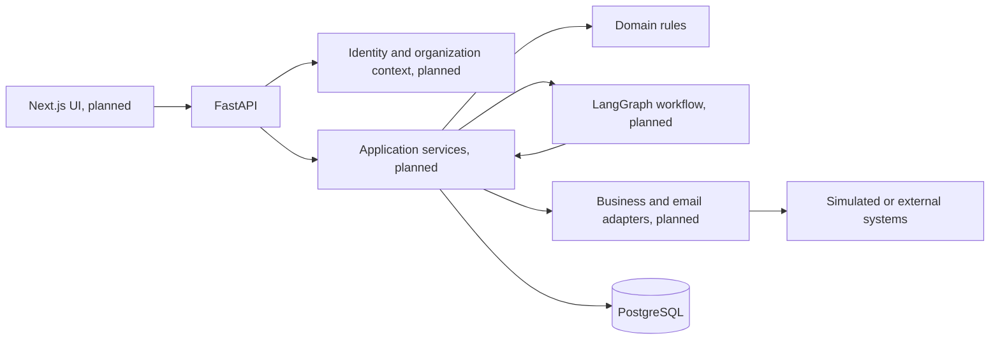

# Architecture

## Recommendation

A modular monolith: FastAPI transport, application services, deterministic domain rules, agent workflow, connector adapters, and SQLAlchemy persistence in one deployable API. PostgreSQL is the transactional store; pgvector and full-text indexing are deferred until document ingestion. A separate Next.js client will call authenticated API endpoints when the business slice is established.

This avoids distributed transactions and operational overhead while keeping connectors and model providers replaceable. The migration cost is mainly extracting a module behind its existing service interface if scale later justifies a separate process.



The agent does not query the database or run adapters directly. Services validate proposals and authorize tool execution with a trusted identity and organization context. LangGraph will persist checkpoints and stop at approval; a transactionally persisted proposal remains the authority for what may execute.

## Initial relational model

The first migration creates organizations, users, memberships, requests, and action proposals. This is a deliberately small subset of the full design. IDs are UUIDs. Tenant-owned rows carry `organization_id`; composite request references prevent proposals from linking across organizations. The unique `(organization_id, source, external_message_id)` key supports intake deduplication where an external ID exists. The unique `(organization_id, idempotency_key)` key supports one proposed action per idempotency key, but by itself does not guarantee exactly-once external execution.

```mermaid
erDiagram
  ORGANIZATIONS ||--o{ MEMBERSHIPS : has
  USERS ||--o{ MEMBERSHIPS : joins
  ORGANIZATIONS ||--o{ REQUESTS : owns
  ORGANIZATIONS ||--o{ ACTION_PROPOSALS : owns
  REQUESTS ||--o{ ACTION_PROPOSALS : proposes
  ORGANIZATIONS { uuid id PK; string name }
  USERS { uuid id PK; string external_subject UK; string email UK }
  MEMBERSHIPS { uuid id PK; uuid organization_id FK; uuid user_id FK; string role }
  REQUESTS { uuid id PK; uuid organization_id FK; string source; string external_message_id; string status }
  ACTION_PROPOSALS { uuid id PK; uuid organization_id FK; uuid request_id FK; string payload_sha256; string idempotency_key; int version }
```

Next schema increments add request messages and attachments, products and compatibility rules, documents and chunks, agent executions and checkpoints, approval decisions, tool invocations, audit events, and usage records. Tenant-scoped foreign keys and indexes must accompany each. Request status transitions will be enforced in a domain service, not through unrestricted CRUD.

## First end-to-end workflow

1. Authenticated operator submits a synthetic email. Server derives organization membership.
2. Intake stores source ID and message in one transaction, deduplicating repeat delivery.
3. Deterministic classifier extracts references and flags missing or ambiguous information.
4. Authorized adapters retrieve product records and active documentation in the same organization.
5. Evidence assessment distinguishes authoritative compatibility from semantic similarity.
6. Draft builder records supporting source IDs and an explicit uncertainty statement.
7. Application service stores an immutable action payload hash and pending proposal.
8. Workflow pauses. Authorized reviewer may edit, reject, or approve the exact version.
9. Executor claims the approved proposal atomically, calls the simulated adapter with its idempotency key, and records result and audit event.

LangGraph and hosted-model drafting will be introduced after this deterministic flow is tested. Their outputs remain untrusted proposals. Production external sends require provider idempotency or a reconciliation path for ambiguous outcomes.

## Operational boundaries

- Public health endpoints expose only status. Business endpoints require authentication and role checks.
- Uploaded content and emails are untrusted. Retrieval filters by organization and document permission before model context construction.
- Logs and traces exclude request bodies and credentials by default.
- PostgreSQL row-level security may add defense in depth later; application authorization remains mandatory.
- M0 uses Docker PostgreSQL without pgvector; the extension is introduced with hybrid retrieval in Milestone 3.
